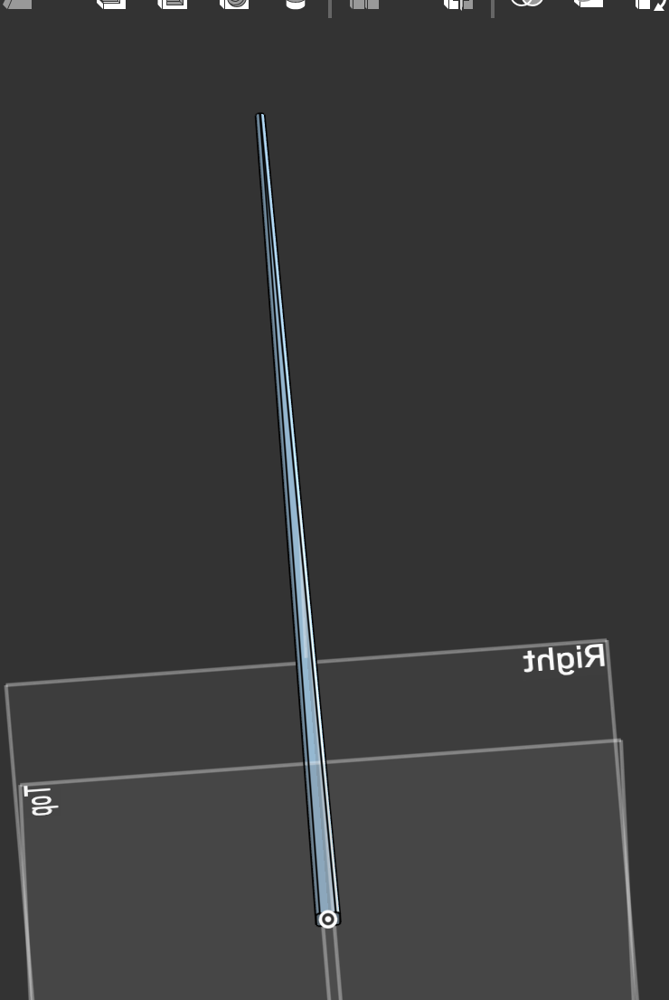

# Oct 30, 2026

So this is going to be my first project that I make regarding metallurgy, I had the idea of making lead chopsticks as a gift to my 3.091 professor (Solid State Chemistry) for letting me know about this. I talked with someone in MIT's foundry and they told me that I could make anything with a relatively low melting as long as I had the CAD so yea.

I originally wanted tungsten chopsticks but it melts at too hot a temperature and yea, I do want to make some out of titanium to learn forgery as well as some out of a custom alloy to learn how to cast metals.

After looking around, I want to make one pair of chopsticks out of CuAl10Fe5Ni5 as I saw that it has a golden-ish color and also is high strength. Later looking at that, I saw that this mixture was toxic and not food safe because acidic foods can break down the copper and cause it to poison the food. I then looked at iron/aluminum alloys and saw that steel was food safe, so after looking through it I was tinkering around with the values and learned about Iron aluminides (80% Iron (Fe), 19.25% Aluminum (Al), and 0.75% Carbon (C)) but iron aluminides are plagued by [room temperature embrittlement](https://link.springer.com/chapter/10.1007/978-1-4613-1215-4_9) which sucks but if I use a high concentration of aluminum (>50%) then this embrittlement dissapears. The other option is heat treating it and it would somehow be fine? From google this would allow the steel to mitigate the brittleness by allowing the kappa-carbides to form inside the grain boundaries instead of along the edge where they are prone to shattering because the carbides can't bend.  WAIT SO WHAT IF I JUST MAKE IT ONE SOLID CRYSTAL. But then it still wouldnt last with acidic foods...

I also learned about "Austentite" which is an alloying element that expands the temperature and cooling range  of rhte austentite (FCC) phase.

I was also looking at Pb95 Cu2.5 Cd2.5 for the gift (ironic lol)

# Oct 31, 2026

I have decided on a composition like this (by weight)
81% Fe 15% Cr 1.5% Co 1% C 1.5% Mo but since the forge might not reach temperatures that high then I might do Grade 420 Stainless Steel.

https://www.sciencedirect.com/science/article/abs/pii/S0169814197001054 

I then started on the cad and made this in like 5 mins

 which is 235mm with a 6mm diamater that tapers to 2 mm at the end and yea.
